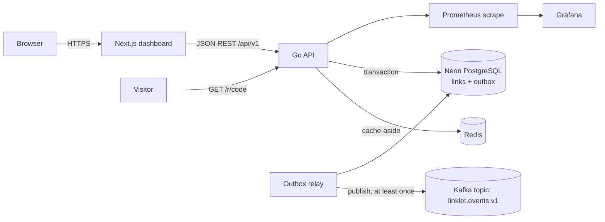
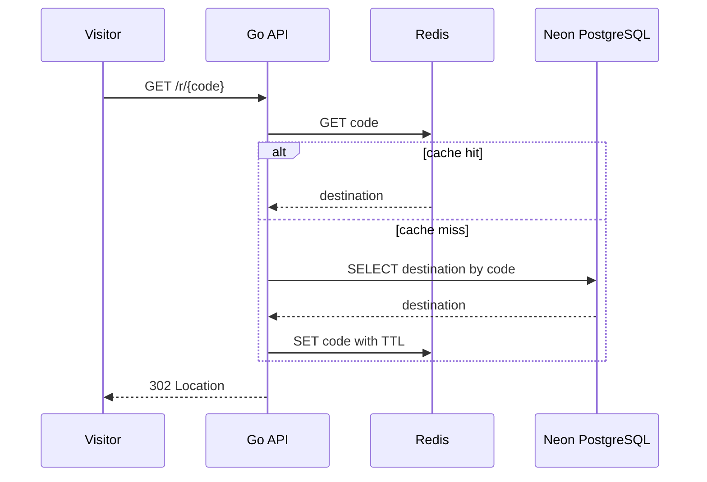

# Linklet system design

## Problem and requirements

Linklet creates compact links and redirects visitors to their destinations. It supports creating a short link with an optional custom code, looking up links through a redirect endpoint, and browsing recent links in a small dashboard. This project uses the URL shortener concept proposed earlier; the selected stack is Next.js, Go, Neon PostgreSQL, Redis, and Kafka.

Functional requirements: validate HTTP(S) destinations, reserve unique codes, persist link creation and its event atomically, redirect efficiently, and keep a cache that can be discarded at any time. Non-functional targets for a single-region deployment: p99 redirect latency below 100 ms at 500 requests/s, p99 create latency below 250 ms at 50 requests/s, 99.9% monthly availability, and read-after-write consistency for the creator. Redirects may briefly return a previously cached destination after a concurrent administrative change; the current API does not expose edits or deletion.

## Capacity estimate

Assume 50 create requests/s and 500 redirect requests/s, with 5% daily link growth. At 150 bytes of row and index storage per link, 4.32 million links/day require about 650 MB/day before database overhead. Cache hit rate target is 90% for hot codes; cache misses go to Neon. Kafka carries one small creation event per link, or 50 messages/s at peak. These are sizing assumptions, not measured benchmark results.

## Architecture and data flow



Creation validates at the HTTP boundary, then inserts the link and a versioned outbox event in the same PostgreSQL transaction. Redirect checks Redis first and reads PostgreSQL on a miss. The relay claims unpublished rows, publishes them with the code as key, and marks them sent. Kafka uses at-least-once delivery; downstream consumers must deduplicate on event ID.

```mermaid
sequenceDiagram
  participant U as Dashboard
  participant A as Go API
  participant D as Neon PostgreSQL
  participant R as Outbox relay
  participant K as Kafka
  U->>A: POST /api/v1/links + Idempotency-Key
  A->>D: begin; replay lookup; insert link + outbox
  D-->>A: commit
  A-->>U: 201 Created (replayable response)
  R->>D: claim unsent outbox rows
  R->>K: publish event keyed by short code
  K-->>R: broker acknowledgement
  R->>D: mark published
```



## Trade-offs and failure modes

PostgreSQL is the source of truth and provides unique constraints and transaction boundaries. Redis is cache-aside with a bounded TTL; cache loss increases database load but never loses links. Kafka is asynchronous and intentionally not part of the create request transaction: the transactional outbox bridges the database/broker boundary. A crash after publish but before marking the outbox row causes a duplicate, so event IDs are stable and consumers deduplicate. The relay retries transient failures with backoff; a persistent broker failure grows the outbox while link creation remains available until database capacity is reached. Database failure returns a generic 503 and no link is acknowledged. Slow database calls are bounded by request contexts. Redis errors fall back to PostgreSQL.

Rejected alternatives: synchronous Kafka publication in the request path would couple availability to the broker and still cannot atomically commit both systems. Offset pagination becomes costly and unstable at scale; the list API uses a descending `(created_at,id)` cursor. Cache invalidation is unnecessary for immutable links; TTL bounds stale data if future mutation is added. Link IDs use random URL-safe codes, with the unique database constraint resolving collisions.

## Scaling and operations

The API and relay scale horizontally. PostgreSQL is the first bottleneck; add read replicas for list and redirect traffic only after accepting replica lag, and partition the links table by creation time when operationally justified. Kafka partitions use short code as the key to keep events for a link ordered. Redis can use a managed cluster and consistent key hashing. Neon connection pooling is enabled in the supplied URL; API pool limits are configurable to avoid exhausting serverless connection limits. The local Compose stack supplies Kafka, Redis, Prometheus, Grafana, API, and frontend; Neon remains a hosted dependency and must be configured with `DATABASE_URL`.

## ADRs

1. **Go API:** small deployment footprint, explicit concurrency and context propagation.
2. **Neon PostgreSQL:** durable relational source of truth, uniqueness, transactions, and managed operations.
3. **Redis cache-aside:** optional acceleration with graceful database fallback.
4. **Kafka plus transactional outbox:** durable asynchronous event delivery with at-least-once semantics.
5. **Opaque random codes:** avoids predictable sequential identifiers and supports collision retries under a database constraint.
