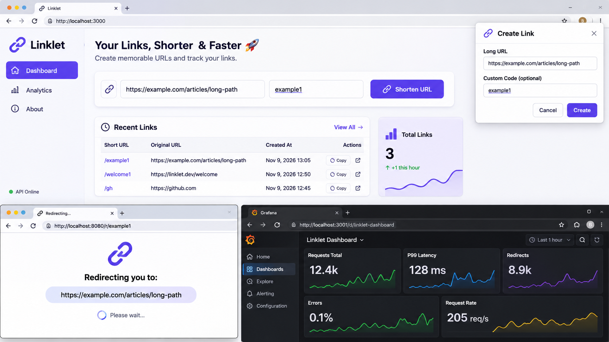
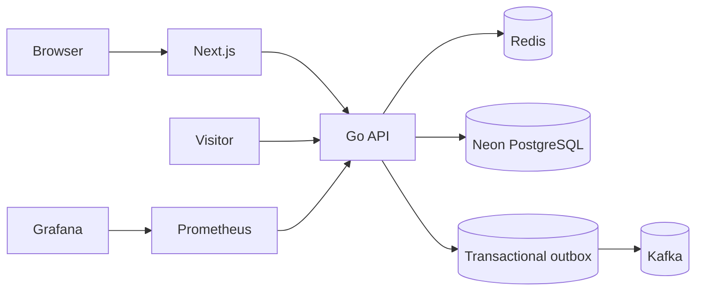

# Linklet
<p align="center">  </p>
Linklet is a full stack short link service: create memorable URLs, browse the recent links in a small dashboard, and redirect visitors through a fast cache backed by durable storage. It is built as a Go modular monolith with a Next.js frontend. PostgreSQL is the source of truth, Redis is an optional cache, and Kafka receives creation events through a transactional outbox.

## Architecture

See [DESIGN.md](DESIGN.md) for capacity assumptions, request flows, failure behavior, scaling notes, and architecture decisions.



## Stack choices

- **Go 1.27:** standard-library HTTP server and explicit context boundaries; `pgx` provides the PostgreSQL driver.
- **Next.js 16 and React 19:** server-rendered application shell with a small client-side dashboard.
- **Neon PostgreSQL:** managed PostgreSQL transactions and constraints; use a pooled Neon connection string.
- **Redis 7:** disposable cache-aside layer; API falls back to PostgreSQL on cache errors.
- **Redpanda (Kafka API):** local Kafka-compatible broker; `kafka-go` publishes outbox events with the short code as ordering key.
- **Prometheus and Grafana:** local metrics scrape and dashboard stack.

The frontend uses the built-in browser fetch API and no additional runtime libraries.

## Quick start

1. Create a Neon project and copy its pooled connection string. It must point to a database where the user can create tables; keep `sslmode=require` enabled.
2. Copy `.env.example` to `.env`, then set `DATABASE_URL` to the Neon connection string. Keep the other local defaults for Compose.
3. Start the stack:

   ```sh
   docker compose up --build
   ```

   The API applies the versioned migration at startup. The frontend is at `http://localhost:3000`; Grafana is at `http://localhost:3001` (user `admin`, password from `GRAFANA_ADMIN_PASSWORD`); Prometheus is at `http://localhost:9090`.

4. Create and resolve a short link:

   ```sh
   curl -i http://localhost:8080/api/v1/links \
     -H 'Content-Type: application/json' \
     -H 'Idempotency-Key: example-create-001' \
     -d '{"url":"https://example.com/articles/long-path","code":"example1"}'
   curl -i http://localhost:8080/r/example1
   curl -s 'http://localhost:8080/api/v1/links?limit=10'
   ```

## API overview

OpenAPI 3 is in [openapi.yaml](openapi.yaml).

| Method and path | Purpose |
| --- | --- |
| `POST /api/v1/links` | Create a link; requires `Idempotency-Key` |
| `GET /api/v1/links?limit=25&cursor=BASE64_CURSOR` | Cursor-paginated recent links |
| `GET /r/{code}` | HTTP 302 redirect |
| `GET /healthz` | Process liveness |
| `GET /readyz` | PostgreSQL and Redis dependency check |
| `GET /metrics` | Prometheus scrape endpoint |

## Configuration

| Variable | Required | Description |
| --- | --- | --- |
| `DATABASE_URL` | yes | Neon PostgreSQL DSN; pooled endpoint recommended |
| `REDIS_URL` | yes | Redis URL, including optional database number |
| `KAFKA_BROKERS` | yes | Comma-separated broker addresses |
| `HTTP_ADDR` | no | API listen address; default `:8080` |
| `FRONTEND_ORIGIN` | yes | Allowed browser origin for the frontend |
| `DB_MAX_OPEN` | no | Database connection cap; default 10 |
| `DB_MAX_IDLE` | no | Idle connection cap; default 5 |
| `NEXT_PUBLIC_API_URL` | no | API base URL used by browser code |
| `NEXT_PUBLIC_LINK_BASE_URL` | no | Base URL used to display shareable links |
| `GRAFANA_ADMIN_PASSWORD` | yes in Compose | Grafana login password |

Pool defaults are sized for a small API deployment and should be multiplied by the number of API replicas and compared with the Neon pooler limit. Connection lifetime and idle time are bounded to release stale pooled connections.

## Development and checks

Install Go 1.27, Node.js 22, Docker Compose, and k6. Then run:

```sh
cd web && npm install && npm run lint && npm run build
cd .. && go test -race ./... && go vet ./... && go build ./cmd/api
```

`make test-integration` runs the PostgreSQL integration test when `DATABASE_URL` is configured. `make migrate-down` applies the reversible initial down migration. `make load-test` runs a k6 read workload; the script targets 100 virtual users and p99 below 250 ms. Record the actual k6 summary when measuring a deployment; no load test has been run for this repository.

After the stack is healthy, `scripts/seed.sh` creates a sample `welcome1` link using a stable idempotency key.

## Project structure

- `internal/domain`: link entity and URL/code validation.
- `internal/application`: create, resolve, and list use cases.
- `internal/ports`: storage and cache boundaries.
- `internal/postgres`: SQL repository, transactional outbox polling, and migration runner.
- `internal/redisstore`, `internal/kafkapub`: outbound Redis and Kafka adapters.
- `internal/httpapi`: REST routes, request validation, middleware, and problem responses.
- `cmd/api`: configuration and explicit dependency wiring.
- `web`: Next.js dashboard.
- `migrations`: reversible PostgreSQL schema changes.
- `deploy`: Prometheus and provisioned Grafana configuration.

## What I would do next

- Add tenant accounts and authorization before supporting private link collections.
- Add Kafka consumer workers with event-ID deduplication and a dead-letter topic when a downstream event consumer is introduced.
- Add distributed rate limiting, request latency histograms, OpenTelemetry exporters, and pool/outbox/cache metrics before public production traffic.
- Evolve schema migrations with expand-and-contract changes; test them against Neon branching environments.
- Evaluate time partitioning and read replicas after measured storage and query growth justify their operational cost.
- For multi-region redirects, replicate immutable link data and explicitly choose the acceptable propagation delay.

## Resume discussion points

- Implemented an atomic PostgreSQL link and event write using a transactional outbox, avoiding a distributed transaction across the database and Kafka.
- Added persisted idempotency replay and cursor pagination backed by database indexes.
- Built a Next.js dashboard and a cache-aside redirect path with Redis failure fallback.
- Containerized the API, frontend, Kafka-compatible broker, cache, and observability stack for repeatable local operation.

These are implementation claims; latency, throughput, and availability measurements should be added only after running the load test against a configured deployment.
